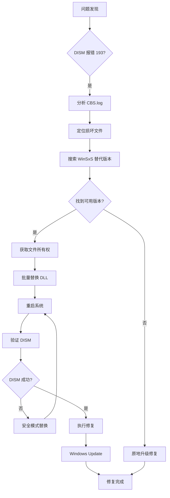

## 问题描述

之前可能用过某些工具关闭了系统更新，现在想恢复遇到了问题，错误码 `0x800700c1`。

- **系统版本**：Windows 10 1809（Build 10.0.17763.379）
- **故障现象**：Windows Update 完全无法工作，DISM 秒报错误 193
- **持续时间**：2026-03-19 ~ 2026-06-04（约 3 个月）
- **根因**：CBS 服务栈核心 DLL 损坏，错误码 `0x800700c1`（ERROR_BAD_EXE_FORMAT）

## 排查与修复流程



## 解决步骤

### 第一步：分析 CBS.log 日志

检查 `CBS.log`，发现 `cbscore.dll` 加载失败，错误重复出现 **14,409 次**。

### 第二步：尝试 DISM 在线修复（失败）

```powershell
DISM /Online /Cleanup-Image /RestoreHealth
```

结果：**错误 193**。

### 第三步：搜索 WinSxS 中可用的 DLL 版本

```powershell
Get-ChildItem -Path C:\WINDOWS\WinSxS -Recurse -Filter cbscore.dll
```

找到 `10.0.17763.164`（可用版本）。

### 第四步：获取 .164 版本完整路径

```powershell
Get-ChildItem C:\WINDOWS\WinSxS\amd64_microsoft-windows-servicingstack_*10.0.17763.164* `
  -Filter cbscore.dll -Recurse | Select-Object -ExpandProperty FullName
```

### 第五步：获取目录权限

```powershell
takeown /F C:\WINDOWS\WinSxS\...10.0.17763.503_... /A /R
icacls C:\WINDOWS\WinSxS\...10.0.17763.503_... /grant Administrators:F /T
```

### 第六步：批量替换所有 DLL

```powershell
$src = "C:\WINDOWS\WinSxS\...10.0.17763.164_..."
$dst = "C:\WINDOWS\WinSxS\...10.0.17763.503_..."
Get-ChildItem $src -File | ForEach-Object {
    $target = Join-Path $dst $_.Name
    if (Test-Path $target) { Copy-Item $_.FullName $target -Force }
}
```

### 第七步：重启后替换剩余锁定文件

重启系统后**立即**再次执行替换脚本——被系统占用的 DLL 只有开机瞬间才能写。

### 第八步：验证 DISM

```powershell
DISM /Online /Cleanup-Image /ScanHealth
```

结果：**操作成功完成**。

### 第九步：执行 DISM 修复

```powershell
DISM /Online /Cleanup-Image /RestoreHealth
```

### 第十步：运行 sfc 修复

```powershell
sfc /scannow
```

### 第十一步：Windows Update 彻底修复

通过 Windows Update 下载最新的 Servicing Stack Update。

## 关键知识点

1. 错误码 `0x800700c1` = DLL 文件损坏（不是权限问题、不是网络问题）
2. `WinSxS` 目录需要 `takeown` 获取权限后才能替换
3. 被锁定的 DLL 需要**重启后立即**替换
4. CBS 服务栈损坏会导致 DISM / sfc / Windows Update **全部失效**
5. 同一 Build 分支内不同修订版的 DLL 可以互替

---

> 原文发布于掘金：[Windows无法更新 CBS 服务栈损坏修复记录](https://juejin.cn/post/7647438845004365859)
